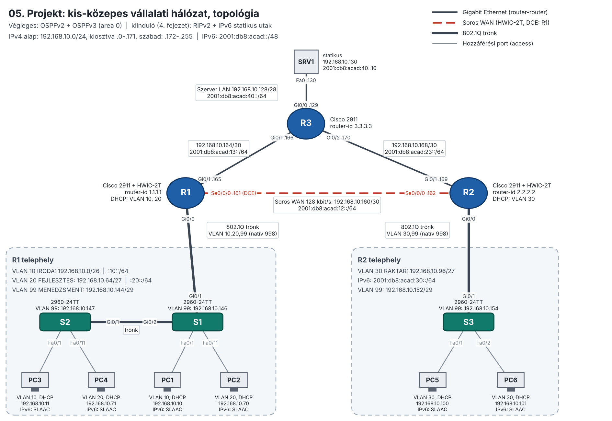

# IKT projektmunka: 05. Projekt

Kis-közepes vállalati hálózat tervezése és megvalósítása IPv4 és IPv6 címzéssel, valamint egy egytáblás adatbázis tervezése, létrehozása, módosítása és lekérdezése. A hálózat Cisco Packet Tracerben készül, a munka menetét PowerPoint bemutató mutatja be.

## A hálózat röviden

- 3 router (R1, R2, R3) háromszögben: R1-R2 soros vonal (128 kbit/s), R1-R3 és R2-R3 Gigabit Ethernet.
- 3 kapcsoló: S1 és S2 az R1 telephelyén, S3 az R2 telephelyén. 6 PC és egy szerver (SRV1, R3 mögött).
- IPv4: a 192.168.10.0/24 hálózat VLSM-mel 9 alhálózatra osztva. IPv6: 2001:db8:acad::/48.
- VLAN-ok: 10 IRODA, 20 FEJLESZTES, 30 RAKTAR, 99 menedzsment, 998 natív, 999 a nem használt portoknak. A VLAN-ok közötti forgalomirányítás router-on-a-stick módszerrel működik.
- Forgalomirányítás: RIPv2 és statikus IPv6 utak, majd áttérés OSPF-re (kísérlet).
- A PC-k DHCP-vel (IPv4) és SLAAC-kal (IPv6) kapnak címet, a hozzáférési portokon portbiztonság van, az eszközök SSH-val kezelhetők.

## Csapat

| Tag (GitHub) | Szerep |
|---|---|
| [opsec-leader6767](https://github.com/opsec-leader6767) | projektvezető |
| [peti709](https://github.com/peti709) | a #18 és a #19 dokumentálása, további szerep: kitöltendő |
| [Balint2010](https://github.com/Balint2010) | kitöltendő |

## Feladatok

| Issue | Feladat | Határidő |
|---|---|---|
| [#13](https://github.com/opsec-leader6767/ikt/issues/13) | Projektindítás és GitHub repó | 1. hét vége |
| [#14](https://github.com/opsec-leader6767/ikt/issues/14) | Címzési terv ellenőrzése és dokumentálása | 1. hét vége |
| [#15](https://github.com/opsec-leader6767/ikt/issues/15) | Topológia felépítése Packet Tracerben | 2. hét vége |
| [#16](https://github.com/opsec-leader6767/ikt/issues/16) | Kapcsolók konfigurálása | 2. hét vége |
| [#17](https://github.com/opsec-leader6767/ikt/issues/17) | Routerek konfigurálása | 3. hét vége |
| [#18](https://github.com/opsec-leader6767/ikt/issues/18) | RIP kontra OSPF kísérlet | 4. hét vége |
| [#19](https://github.com/opsec-leader6767/ikt/issues/19) | Portbiztonság bemutatása | 5. hét vége |
| [#20](https://github.com/opsec-leader6767/ikt/issues/20) | Tesztelés és hibanapló | 6. hét vége |
| [#21](https://github.com/opsec-leader6767/ikt/issues/21) | Adatbázis tervezése és létrehozása | 5. hét vége |
| [#22](https://github.com/opsec-leader6767/ikt/issues/22) | SQL lekérdezések és módosítások | 6. hét vége |
| [#23](https://github.com/opsec-leader6767/ikt/issues/23) | Bemutató, végső dokumentáció és értékelés | 7. hét vége |

A követelmények és a feladatok kapcsolata: [docs/kovetelmenyek.md](docs/kovetelmenyek.md).

## Mappák

| Mappa | Tartalom |
|---|---|
| `halozat/` | Packet Tracer fájl (`projekt05.pkt`) |
| `halozat/konfigok/` | az eszközökről exportált running-configok (`show running-config`) |
| `adatbazis/` | SQL fájlok és a táblaterv |
| `docs/` | követelménylista, címzési terv, jegyzőkönyvek |
| `docs/kepek/` | képernyőképek, topológia ábra |
| `bemutato/` | PowerPoint bemutató |

## Dokumentáció

| Fájl | Tartalom | Issue |
|---|---|---|
| [docs/kovetelmenyek.md](docs/kovetelmenyek.md) | a 05. Projekt követelményei és a hozzájuk tartozó issue-k | #13 |
| [docs/cimzesi-terv.md](docs/cimzesi-terv.md) | VLSM (IPv4) és IPv6 címzési terv a számítás lépéseivel | #14 |
| [docs/eszkozleltar.csv](docs/eszkozleltar.csv) | eszközök, portok, VLAN-ok és címek, az adatbázis kiinduló adata | #21 |
| [docs/forgalomiranyitas.md](docs/forgalomiranyitas.md) | RIP kontra OSPF mérési jegyzőkönyv (sablon) | #18 |
| [docs/portbiztonsag.md](docs/portbiztonsag.md) | a portsértési módok bemutatása (sablon) | #19 |
| [docs/teszt-jegyzokonyv.md](docs/teszt-jegyzokonyv.md) | ping, tracert, SSH és konfiguráció-ellenőrzések (sablon) | #20 |
| [docs/hibanaplo.md](docs/hibanaplo.md) | az építés közben előfordult hibák (sablon) | #20 |

A szövegfájlok Windows-os sorvégekkel (CRLF) készülnek, hogy a Jegyzettömb is jól mutassa őket. A `.gitattributes` miatt a git ezeket nem alakítja át.

## Értékelés

A projekt értékelése (szakszerűség, kidolgozottság, funkcionális működés, dokumentálás) és a csoporton belüli százalékos elosztás menete a [#23](https://github.com/opsec-leader6767/ikt/issues/23) issue-ban van leírva.
